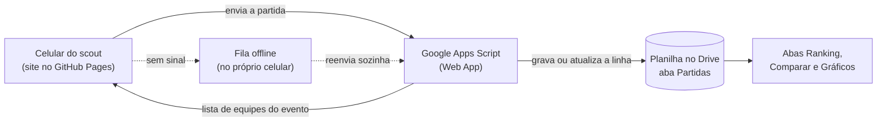

# BIOBUZZ Scout · versão Planilha

Clone do site de scouting da equipe para a temporada FTC 2026-27 (BIOBUZZ). O front e o login continuam os mesmos do site atual. A diferença é para onde vão os dados: cada partida registrada vira uma linha numa planilha do Google Drive, e toda a análise (ranking, comparação, gráficos) é feita na própria planilha.

> Status: **código pronto e testado localmente** (09/11/2026). Falta publicar o Apps Script e o GitHub Pages; ver [Implantação](#implantação). O plano está em [`PLANEJAMENTO.md`](PLANEJAMENTO.md).

## Por que um clone

O site atual é uma página publicada no claude.ai e guarda os dados no banco do próprio claude.ai. Páginas publicadas lá não conseguem enviar dados para sites de fora (incluindo o Google), então não dá para fazê-lo gravar numa planilha. O clone resolve isso morando fora do claude.ai, num link próprio no GitHub Pages.

O site atual continua existindo; os dois são independentes.

## Arquitetura



| Peça | O que é | Custo |
|---|---|---|
| Front | O HTML atual, reduzido ao login e ao formulário de scout, hospedado no GitHub Pages | grátis |
| Ponte | Um Google Apps Script preso à planilha e publicado como Web App. Recebe os envios, confere a senha da equipe e grava a linha | grátis |
| Dados e visualização | Uma planilha Google com abas de dados brutos e abas calculadas por fórmula | grátis |

Não há servidor para manter, projeto no Google Cloud, chave de API nem banco de dados.

## O que muda em relação ao site atual

**Fica igual**
- Senha da equipe: pedida **na primeira tela, antes do nome**, conferida na hora pelo Apps Script e lembrada no aparelho (não é pedida de novo). Sem internet no primeiro acesso, é aceita provisoriamente e conferida quando a conexão voltar; se estiver errada, o site pede de novo sem perder partidas nem rascunho.
- Nome do scouter: pedido logo depois da senha e lembrado.
- Formulário de partida guiado em etapas, com botões grandes. A validação é **por etapa**: ao tocar em Próximo, os campos obrigatórios vazios ficam marcados em vermelho e o site não avança.
- Contadores (bolas, tips, GARDEN) começam em 0, e 0 é uma resposta válida.
- Envio automático: ao salvar, ao abrir o site, ao voltar a conexão e com novas tentativas sozinhas (4 s, 8 s, 16 s, depois a cada 30 s). O topo mostra só o estado da conexão e das partidas guardadas.
- Feito para celular: etapas numa barra fixa no rodapé (timeline navegável), com Próximo em verde e Voltar em vermelho. A barra some enquanto o teclado está aberto.

**Sai do site** (passa a ser feito na planilha ou deixa de existir)
- Pit scout.
- Ranking, comparação de equipes e lista de partidas registradas.
- Escala de scouting (`assignments`).
- Editar e excluir partidas, e a senha de exclusão `16786`. Correções passam a ser feitas direto na planilha.
- Exportar CSV/JSON (a planilha já é o arquivo).

**Novo**
- Aviso de conexão: "Tudo enviado" ou "Sem conexão: N partida(s) guardada(s) neste aparelho", com um link discreto "Tentar agora".
- **Mapa de tiro**: no lugar do texto livre, uma grade 6×6 sobre a imagem da arena (`assets/arena.png`). Toque marca a célula, segundo toque faz dela a principal (★), terceiro desmarca. Robô da Aliança Azul vê a arena girada 180°, então o código gravado é sempre do ponto de vista da própria aliança (ela à esquerda).
- **Placar final da aliança** (opcional), digitado no fim da partida. Alimenta o OPR e a sinergia na planilha.
- O scout escolhe o evento (Seletiva RS ou Evento teste) e só consegue escolher equipes cadastradas na aba Equipes daquele evento, num seletor com busca por número ou nome.
- Aviso de duplicata: antes de salvar (mesma equipe, partida e tipo já enviados do aparelho) e depois do envio (o script avisa se outro scout já registrou).

## Fluxo de uso

1. O scout abre o link e digita a senha da equipe e depois o nome (só na primeira vez).
2. Preenche a partida nas etapas do formulário e toca em salvar.
3. O site envia sozinho para o Apps Script.
4. A linha aparece na aba **Partidas** em segundos, e as abas de análise se atualizam sozinhas.
5. Sem sinal, a partida fica na fila e é enviada quando a conexão voltar.

## Planilha

| Aba | Conteúdo | Quem escreve |
|---|---|---|
| **Partidas** | Dados brutos: uma linha por equipe observada numa partida | só o Apps Script |
| **Equipes** | Número e nome das equipes do evento (único dado carregado antes do evento) | a equipe, à mão |
| **Ranking** | Médias por equipe e pontuação estimada, ordenadas | fórmulas |
| **Comparar** | Até 4 equipes lado a lado, escolhidas em listas suspensas | fórmulas |
| **Gráficos** | Barras por equipe (SPARKLINE) a partir do Ranking: pontuação estimada e bolas auto/teleop | fórmulas |
| **Mapa de tiro** | Para uma equipe: % das partidas em que atirou de cada célula e em que ela foi a principal | fórmulas |
| **Placar real** | Uma linha por aliança-partida com placar; OPR por equipe (regularizado pela média do scout) | fórmulas |
| **Config** | Valores de pontuação; pesos da sinergia e λ do OPR (linhas 10–15) | a equipe, à mão |
| **_calc**, **_calcCmp**, **_tiro** (ocultas) | Métricas por equipe que alimentam Ranking, Comparar, Gráficos e Mapa de tiro | fórmulas |

O Comparar também mostra o perfil de estratégia de cada equipe e a **sinergia da aliança**: desconta da soma das médias os conflitos de posição inicial, de fonte de coleta no auto e de zona de tiro.

**Layout de referência.** Parte das abas de análise (filtros por tipo de partida, `_calcCmp`, Mapa de tiro, Placar real, sinergia) foi montada direto na planilha de teste. Ela é a referência: para levar o layout às outras planilhas, rode `copiarLayoutDoTeste()` no editor do Apps Script. Ele recria as abas de análise a partir da planilha de teste e não toca em Partidas (só acrescenta o cabeçalho `placarAlianca` em AD) nem em Equipes. O `setup()` só monta o layout básico em planilhas novas e pula as que já têm `_calcCmp`, para não apagar nada.

Cada evento tem a sua planilha com essa mesma estrutura, então o Evento teste nunca mistura dados com a Seletiva RS:

| Evento | Planilha |
|---|---|
| Seletiva RS | `BIOBUZZ Scout · Seletiva RS` (o `setup()` já carrega as 12 equipes inscritas) |
| Evento teste | `BIOBUZZ Scout · Evento teste` (já vem com 8 equipes fictícias, 1001 a 1008) |

As abas de dados e fórmulas têm proteção só de aviso: quem edita vê um alerta antes, mas pode corrigir.

### Colunas da aba Partidas

Mesmo modelo de dados do site atual, sem os campos de versão e edição.

| Coluna | Conteúdo |
|---|---|
| `id` | identificador gerado no celular quando o formulário é aberto (garante que reenvios não dupliquem) |
| `recebidoEm` | data e hora em que o Apps Script gravou |
| `criadoEm` | data e hora em que o scout salvou no celular |
| `scouter` | nome de quem registrou |
| `match`, `team` | número da partida e da equipe |
| `origin`, `type`, `alliance` | evento, tipo (Treino, Qualificatória, Playoff) e aliança (Vermelha, Azul) |
| `aStart`, `aHas`, `aLeave`, `aPark`, `aCollect`, `aAcc` | autônomo: local de saída, teve autônomo, LEAVE, PARK, coleta, precisão |
| `aBalls`, `aTips` | autônomo: bolas na HIVE e tips |
| `tBalls`, `tTips`, `tGarden` | teleop: bolas na HIVE, tips e elementos no GARDEN |
| `tFlower`, `tPark`, `tBroke`, `tAcc` | teleop: flor, PARK, pifou, precisão |
| `shootSpeed`, `robotSpeed`, `notes` | observações |
| `shootSpot` | mapa de tiro: células `A1`…`F6` separadas por `;`, a principal com `*` (ex.: `C3*;C4`). Colunas A–F da esquerda para a direita, linhas 1–6 de cima para baixo, sempre com a aliança do robô à esquerda. Registros antigos em texto livre ficam, mas o mapa os ignora |
| `pontosEstimados` (AC) | coluna de fórmula (ARRAYFORMULA em AC1). Nada é gravado nela |
| `placarAlianca` (AD) | placar final da aliança, 0–999 ou vazio. Gravado à parte, depois de A..AB, para não tocar na fórmula de AC |

Sim e Não ficam como texto. Os pontos estimados são calculados na planilha com os valores da aba Config: LEAVE 3, PARK 5 no autônomo e 5 no fim, HIVE TIP 20, GARDEN 1 por elemento. Bolas na HIVE não pontuam; são só dado estatístico.

## Contrato do Apps Script

O site envia em `text/plain` com JSON no corpo, para evitar a checagem prévia de CORS que o Apps Script não responde.

| Chamada | Corpo / parâmetros | Resposta |
|---|---|---|
| `POST` | `{ "key": "<senha da equipe>", "row": { ...campos... } }` | `{ "ok": true, "id": "...", "status": "created" \| "updated", "dup": null \| { "scouter": "...", "criadoEm": "..." } }` |
| `POST` | `{ "key": "<senha>", "action": "auth" }` | `{ "ok": true, "auth": true }` ou `bad_key`. Usado na primeira tela. (Um script sem essa ação responde `bad_row` para senha certa; o site aceita as duas.) |
| `GET ?action=teams` | — | `{ "ok": true, "events": [{ "name": "Seletiva RS", "teams": [{ "team": 12345, "name": "..." }] }] }` |
| `GET ?action=ping` | — | `{ "ok": true }` |

Erros: `{ "ok": false, "error": "bad_key" | "bad_row" | "bad_event" | "bad_team" | "busy" }`. `bad_key` faz o site pedir a senha de novo. `bad_row`, `bad_event` e `bad_team` deixam a partida na fila marcada com o motivo (com opção de descartar) sem travar as outras. `busy` e falha de rede ficam na fila e são tentados de novo.

Regras no script:
- **Evento → planilha**: o campo `origin` escolhe a planilha (constante `EVENTS` no `Code.gs`).
- **Validação**: campos obrigatórios, valores das listas, equipe existente na aba Equipes do evento, `shootSpot` no formato do mapa (no máximo uma principal; o script normaliza para principal primeiro e o resto em ordem alfabética) e `placarAlianca` inteiro de 0 a 999 ou vazio.
- **Upsert pelo `id`**: se a linha já existe, é atualizada; senão, é acrescentada no fim.
- **Trava** (`LockService`) para envios simultâneos de vários celulares.
- **Senha da equipe** guardada nas propriedades do script, nunca no código do site.
- Publicação: *Executar como: eu* e *Quem tem acesso: qualquer pessoa*.

## Estrutura do repositório

```
index.html                  o site (login + formulário)
config.js                   URL do Apps Script e lista de eventos
assets/arena.png            arena vista de cima, recortada no campo (6×6 tiles), usada no mapa de tiro e na aba Mapa de tiro
apps-script/Code.gs         código do Apps Script (cópia de referência; ele roda no Google)
apps-script/test/           testes locais: mock-test.js (script) e e2e.js (site + script, Playwright)
README.md                   este arquivo
PLANEJAMENTO.md             fases, tarefas e decisões
```

Testes locais: `node apps-script/test/mock-test.js` e `node apps-script/test/e2e.js` (precisa do Playwright com Chromium).

## Implantação

As planilhas ficam na pasta **Scout Biobuzz** do Drive de goncalvesisaque772@gmail.com.

> Se o navegador tiver várias contas Google logadas, o editor do Apps Script costuma falhar com "Não foi possível abrir o arquivo". Faça os passos abaixo numa janela anônima logada só com a conta dona das planilhas.

1. Abra a planilha **BIOBUZZ Scout · Seletiva RS** > Extensões > Apps Script (ou crie um projeto avulso em script.google.com; o código funciona dos dois jeitos).
2. Apague o conteúdo de `Código.gs` e cole o `apps-script/Code.gs`. Salve.
3. Configurações do projeto (engrenagem) > Propriedades do script > Adicionar: `SCOUT_KEY` = senha da equipe.
4. No editor, escolha a função `setup` e clique em Executar. Autorize com a conta dona das planilhas. Ela monta as abas das duas planilhas e pode ser rodada de novo sem perder dados.
5. Implantar > Nova implantação > tipo App da Web. Executar como: **eu**. Quem pode acessar: **qualquer pessoa**. Copie a URL que termina em `/exec`.
6. Cole a URL em `config.js` (`scriptUrl`).
7. Para atualizar o script depois: Implantar > Gerenciar implantações > lápis > Versão: nova versão. Assim a URL não muda.
8. GitHub Pages: Settings > Pages > Deploy from a branch > `main` / root.

## Segurança e limites

- O endereço do Apps Script fica visível no código do site. Quem impede envios de fora é a senha da equipe, conferida no script.
- Quem pode ver e editar os dados é definido pelo compartilhamento da planilha no Drive.
- A aba Partidas deve ser protegida para que só o dono (e o script) edite; correções feitas por poucas pessoas autorizadas.
- Cada envio leva de 1 a 3 segundos. O Apps Script aguenta com folga o volume de uma equipe de scouting, mas não é tempo real como o site atual.
- Sem histórico de alterações além do histórico de versões da própria planilha.
